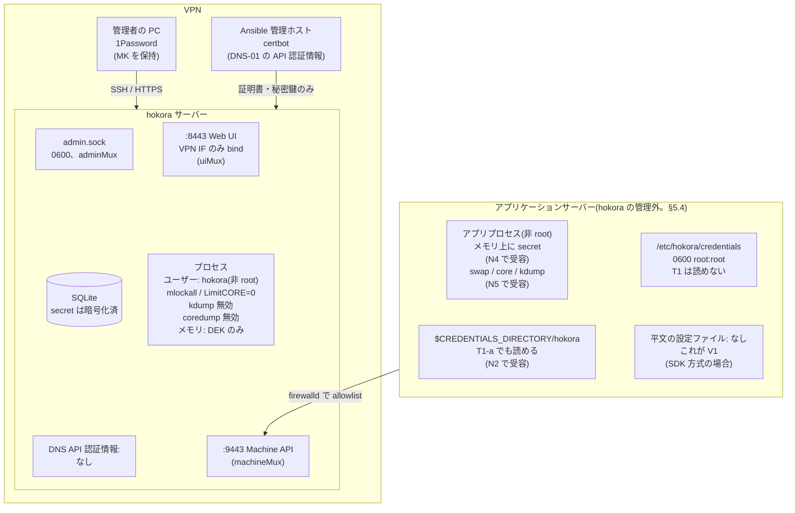
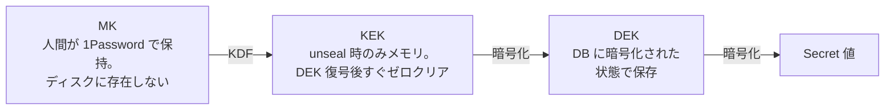
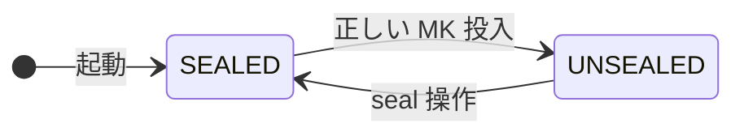

# hokora 脅威モデル

本文書は hokora が **何から守るか** と **何を守らないか** を明示する。
実装上の判断はすべてこの文書に従属する。ここに書かれていない防御は、
「実装漏れ」ではなく「意図的な非目標」である。

**この文書は hokora の限界を正直に記述する。** 秘匿情報管理製品の多くが
曖昧にしている部分について、hokora は明示的に「守らない」と書く。

---

## 1. 背景と動機

### 1.1 解決しようとしている問題

従来、各アプリケーションサーバー上で以下の運用が行われていた。

- DB 接続情報・API キー等の秘匿情報を、アプリケーションサーバーのローカルファイルに
  平文(あるいは復号可能な状態)で配置
- 結果として、アプリケーションサーバーへの侵入が、そのまま **全秘匿情報の漏洩** に直結する
- 秘匿情報の更新には、各サーバーへのファイル配布と再デプロイが必要
- 誰がいつどの秘匿情報にアクセスしたかの記録がない

セキュリティ監査において、この構造が脆弱であるとの指摘を受けた。

### 1.2 hokora の目的

**アプリケーションが秘匿情報の設定ファイルを必要としない状態にし、
アプリケーションサーバーが持つ長期的な秘密を、N 個の secret から
1 個の失効可能な machine credential に置き換える。**

| 項目 | 導入前 | 導入後 |
|------|--------|--------|
| アプリサーバーに**配置する**平文 secret | N 個 | **0 個** |
| アプリサーバーに配置する認証情報 | — | 1 個(machine credential) |
| アプリプロセスの**メモリ上**の secret | あり | **あり**(変わらない。N4) |
| **メモリからディスクへの漏洩経路**(swap / core dump / kdump) | あり | **あり**(hokora は制御できない。§5.4) |
| 侵害時の漏洩範囲 | 全 secret | **当該 machine の grant 範囲のみ** |
| 侵害後の遮断手段 | 全サーバーへの手動配布 | **revoke 1 回**(ただし §5.1 参照) |
| アクセスの記録 | なし | **全て監査ログに記録** |
| secret の更新 | 各サーバーへ配布 + 再デプロイ | 中央で完結 |

**「0 個」は「hokora が配置を要求しない」という意味である。**

以下は hokora の管理外であり、「ディスク上に平文 secret が絶対に存在しない」
ことを hokora は保証しない:

- アプリケーションプロセスのメモリが swap / core dump / kdump 経由で
  ディスクに書かれること(§5.4)
- アプリケーション自身が secret をログやクラッシュレポートに出力すること
- `hokora-client run` 方式における `/proc/<pid>/environ`(§5.1)

**この区別を曖昧にしない。** 過大な主張は、利用者に誤った安心を与える。

### 1.3 hokora が解決しない問題:secret zero problem

**hokora は「アプリケーションサーバーから秘密を完全に消す」ことはできない。**

hokora から secret を取得するには、hokora に対して認証する必要がある。その認証情報
(machine credential)は、アプリケーションが到達できる場所になければならない。
アプリケーションが到達できるということは、**アプリケーションと同じ権限を得た攻撃者も
到達できる** ということである。

これは「secret zero problem」あるいは「turtles all the way down」として知られる、
秘匿情報管理製品に共通の原理的限界である。Infisical も HashiCorp Vault も
同じ制約を持つ。

**この問題を解けるのは、インフラ層がワークロードのアイデンティティを保証できる
環境のみである**(AWS の IAM Role、GCP のサービスアカウント等)。hokora の
デプロイ対象であるさくら VPS 上では、この手段が存在しない。

したがって hokora の到達点は「秘密をゼロにする」ではなく「秘密を 1 個に圧縮し、
その 1 個を分離・監視・失効可能にする」である。§5.1 で詳述する。

### 1.4 なぜ既存製品ではないのか

Infisical を実際に導入し、機能面では要求を満たすことを確認した。しかし:

- PostgreSQL + Redis + アプリケーション本体という構成が必須
- Docker 込みで常時 500MB 以上のメモリを消費
- マルチテナント SaaS を self-host 可能にした設計に由来する機能過剰

単一組織・2 名・数プロダクトという規模に対して、運用コストが釣り合わない。

**hokora は Infisical より安全ではない。** 提供する防御はほぼ同等であり、
差分は構成の軽量さと、機能の絞り込みにある。

HashiCorp Vault も同様に、本プロジェクトの規模に対して過剰である。

SOPS + age も検討したが、Web UI による閲覧・編集を要件としたため採用しなかった
(詳細は `docs/DESIGN.md` §13.1)。

---

## 2. 保護資産

| # | 資産 | 説明 | 重要度 |
|---|------|------|--------|
| A1 | Secret 値 | DB パスワード、API キー等の秘匿情報の平文 | 最高 |
| A2 | マスターキー (MK) | DEK を暗号化する鍵。unseal に必要 | 最高 |
| A3 | DEK (Data Encryption Key) | Secret 値を暗号化する鍵 | 最高 |
| A4 | Machine credential (client_secret) | クライアントがサーバーに認証するための長期認証情報 | 高 |
| A5 | Web UI セッショントークン | 認証後は当該ユーザーと同等の権限を持つ bearer credential | 高 |
| A6 | TLS 秘密鍵 | サーバー証明書の秘密鍵 | 高 |
| A7 | 監査ログ | 誰がいつ何にアクセスしたかの記録 | 中 |
| A8 | 人間ユーザーのパスワードハッシュ | Web UI ログイン用 | 中 |

**注:** DNS-01 の API 認証情報は保護資産に含まれない。**hokora サーバー上に
置かないため**(§5.2、DESIGN §3.6)。

---

## 3. 想定する攻撃者

### T1: アプリケーションサーバーへの侵入者(アプリユーザー権限)

**最も重視する攻撃者。** hokora の存在意義そのもの。

以下の 2 つの水準を区別する。**この区別が V1 の正確な理解に必要である。**

| 水準 | 能力 | 例 |
|------|------|-----|
| **T1-a** | アプリユーザー権限で**任意のファイルを読める** | パストラバーサル、LFI、設定ファイルの誤公開 |
| **T1-b** | アプリユーザー権限で**任意のコードを実行できる** | RCE、デシリアライゼーション、コマンドインジェクション |

**hokora はいずれの水準に対しても、部分的な防御しか提供しない**(§5.1)。

### T2: ネットワーク上の受動的/能動的攻撃者

- hokora サーバーとクライアント間の通信を盗聴・改竄しようとする攻撃者
- **インターネット上から Machine API に到達しようとする攻撃者**

**hokora はこの攻撃者から資産を守る。** ただし §5.2 の運用要件
(IP allowlist)が満たされている場合に限る。

### T3: hokora サーバーのディスク・バックアップを取得した攻撃者

- VPS のディスクイメージ、バックアップファイルを取得した攻撃者
- 事業者側の障害、誤操作によるバックアップ流出を含む

**hokora は、サーバーが sealed 状態(または停止中)である限り、この攻撃者から
A1 を守る。** ただし §5.3 の運用要件が満たされている場合に限る。

### T4: アプリケーションサーバーのディスクを取得した攻撃者

**§5.4 で扱う。hokora はこの攻撃者から A1 を守らない。**

---

## 4. 想定しない攻撃者(非目標)

### N1: hokora サーバーの権限を取得した攻撃者

hokora サーバーが unsealed 状態であれば、メモリ上に DEK が存在する。
hokora プロセスと同じ権限、または root 権限があれば `/proc/<pid>/mem` から読み出せる。

**この前提のため、hokora サーバーは他のアプリケーションと同居させず、
攻撃面を最小に保つ運用が前提となる。**

### N2: secret zero problem を解くこと

§1.3 の通り。**アプリユーザー権限を取得した攻撃者が、当該 machine に
許可された範囲の secret を取得することを、hokora は防がない。**

### N3: 内部犯行

正規の認証情報を持つ人間による意図的な情報持ち出し。
監査ログにより事後の検出可能性は上げるが、防止はしない。

### N4: クライアント側の実行時メモリからの窃取

アプリケーションが動作している以上、そのメモリ上には必ず平文の secret が存在する。
これは原理的に防げない。

### N5: アプリケーションサーバー上のメモリからディスクへの漏洩

**§5.4 で詳述。** hokora はアプリケーションサーバーの swap / core dump / kdump を
制御できない。運用要件として推奨はするが、**hokora の防御としては数えない**。

### N6: サイドチャネル攻撃

タイミング攻撃、電力解析等。秘密の比較に定数時間比較を使う程度の対策はするが、
本格的な対策はしない。

### N7: DoS 攻撃

**hokora は DoS 攻撃を防ぐことを目標としない。**

ただし、自明な増幅経路(認証エンドポイントでの重い KDF 等)を残すのは
設計上の怠慢であるため、基本的な耐性は実装する(DESIGN §7.4)。

**プロセス内のレート制限には原理的な限界がある。** 多数の送信元 IP を持つ攻撃者は、
上限つき map を埋めることで正規のバケットを LRU で追い出し、制限をリセットできる。
上限つき map は「メモリ枯渇を防ぐ」ためのものであり、「制限を保証する」ものではない。

**credential ごとの上限(第二段)は、machine ごとに緩められる**(DESIGN §7.4)。
起動のたびに認証するプログラムが、正規の使い方で既定の 10 回/分を超えるためである。
これで変わることと、変わらないこと:

- **緩めた machine の credential に対する総当たりは、その分だけ速くなる**
  (最大で 3 倍の 30 回/分)。client_secret は 256 ビットの乱数なので、
  この差は総当たりの成否を変えない。第二段は総当たりを防ぐ仕組みではなく、
  1 つの credential への負荷を抑える網である
- **送信元 IP ごとの上限(第一段)は変わらない。設定もできない**
- **上限を上げてあることは、client_id を知っていれば secret なしで観測できる。**
  既定値を超えて試したときの応答(401 か 429 か)が違う。漏れるのは「その
  client_id は存在し、上限を上げてある」である。client_id は 100 ビットの乱数で、
  知らない者が探し当てることはできない。**受容する**
- 緩められるのは Web UI の admin だけで、変更は監査に残る

### N8: 高度な持続的脅威(APT)

対象外。

---

## 5. 防御が成立する仕組み(と、成立しない範囲)

### 5.1 T1(アプリサーバー侵入)に対して

**この節が hokora の中核である。過大な主張をしないよう慎重に記述する。**

#### アプリケーションサーバー上に存在するもの

**SDK 方式(`hokora.Fetch()` でメモリに取得)の場合:**

| 項目 | 場所 | T1-a(ファイル読み取り) | T1-b(コード実行) |
|------|------|----------------------|-----------------|
| Secret の平文(設定ファイル) | **存在しない** | — | — |
| Machine credential(ソース) | `/etc/hokora/credentials`(0600 root:root) | **読めない** | **読めない** |
| Machine credential(展開先) | `$CREDENTIALS_DIRECTORY/hokora` | **読める** | **読める** |
| プロセスのヒープ上の secret | プロセスメモリ | 実質読めない(注) | **読める** |

**注:** `/proc/self/mem` はファイルとして存在するが、読み出しには対象アドレスへの
`seek` が必要であり、単純な LFI/パストラバーサルでは実質的に読めない。
`/proc/self/maps` と組み合わせた高度な攻撃は理論上可能。

**`hokora-client run` 方式(環境変数に展開)の場合:**

| 項目 | 場所 | T1-a(ファイル読み取り) | T1-b(コード実行) |
|------|------|----------------------|-----------------|
| **Secret の平文** | **`/proc/<pid>/environ`** | **読める** ← **重要** | **読める** |

**`/proc/self/environ` はファイルであり、パストラバーサル/LFI の古典的な
ターゲットである。** したがって `hokora-client run` 方式では、**T1-a の攻撃者が
credential ではなく secret 値そのものを直接読める**。

#### systemd LoadCredential= の実際の挙動

`LoadCredential=` は、root がソースファイル(0600 root:root)を読み、
`$CREDENTIALS_DIRECTORY` 配下に **サービスの実行ユーザーが読める形で** 展開する。
そうでなければアプリケーション自身が credential を使えないため、これは仕様通りの動作である。

**したがって、T1-a(ファイル読み取りのみ)であっても、machine credential は読める。**

#### T1 攻撃者にできること

```
アプリに任意ファイル読み取り(T1-a)または RCE(T1-b)
  ↓
【SDK 方式】
  $CREDENTIALS_DIRECTORY/hokora を読む  ← T1-a でも可能
    → client_id / client_secret を取得
    → Machine API に到達できる場合、grant 範囲の secret を全て取得

【hokora-client run 方式】
  /proc/<pid>/environ を読む            ← T1-a でも可能
    → secret 値そのものを直接取得(credential を経由しない)
```

**いずれも防げない。N2(secret zero problem)として明示的に受容する。**

**最後のステップは Machine API への到達性に依存する**(SDK 方式の場合)。
T1-a の攻撃者が credential を読めても、そこから hokora に接続できなければ
使えない。これが §5.2 の IP allowlist が防御として意味を持つ理由である。
ただし、**攻撃されたアプリサーバー自身は allowlist に載っている**ため、
そのサーバーから接続される場合は防げない。allowlist が防ぐのは
「credential を外部に持ち出して別の場所から使う」ケースである。

#### それでも hokora が提供する価値

| # | 価値 | 説明 | 限界 |
|---|------|------|------|
| V1 | **平文の設定ファイルを配置しなくてよい** | 設定ファイルの誤公開、誤った git commit、ログへの混入では **secret 値そのものは漏れない**。漏れるのは失効可能な credential | **`hokora-client run` 方式では成立しない**(T1-a で `/proc/<pid>/environ` から secret 値が漏れる)。**SDK 方式でのみ成立する** |
| V2 | **被害範囲が grant で限定される** | 侵害されたアプリサーバーから取れるのは、当該 machine に grant された environment のみ | grant を広く与えれば失われる |
| V3 | **credential を失効できる** | revoke 1 回で当該 machine を遮断できる。他の machine には影響しない | **revoke で止まるのは「今後の取得」のみ。** 攻撃者が revoke 前に取得した secret 値は、個別にローテーションしなければ回復しない |
| V4 | **アクセスが記録される** | 異常な取得パターンを監査ログから検出できる | 実際に見なければ意味がない |
| V5 | **ローテーションが現実的になる** | 中央で更新すれば全アプリに反映される | — |

**V1 と V3 の正確な理解:**

| 状況 | 導入前 | 導入後(SDK 方式) |
|------|--------|-----------------|
| 設定ファイルが漏れた | 全 secret が漏れる。**各 secret を個別にローテーションしなければ回復しない** | credential 1 個が漏れる。**revoke で今後の取得は止まる。ただし攻撃者が既に secret を取得していれば、それらは個別にローテーションが必要** |

**改善されるのは「漏洩の検知と遮断が可能になること」と「気づいた時点で
被害を止められること」であり、「漏れたものが自動的に無害になること」ではない。**

**「任意コード実行が必要になる」わけではない。** T1-a でも credential は盗める。

#### 防御が依存する前提

1. **アプリケーションは非 root で実行すること**
2. **machine ごとに credential を分けること**(V2)
3. **grant を最小にすること**(V2)
4. **監査ログを実際に見ること**(V4)
5. **Machine API に IP allowlist を設定すること**(§5.2)
6. **SDK 方式を使うこと。`hokora-client run` は V1 を無効化する**(§5.1)

これらは OPERATIONS.md に運用要件として記述する。

### 5.2 T2(ネットワーク攻撃者)に対して

#### TLS

- すべての通信を TLS で保護する
- **独自の暗号プロトコルは実装しない**
- 証明書は Let's Encrypt(DNS-01)で取得した公的 CA 由来のものを使う
- **クライアントは `InsecureSkipVerify` 相当の機能を持たない。実装してはならない**
- クライアントはホスト名検証を必ず行う

#### 公的 CA を選んだことのトレードオフ

**Let's Encrypt の証明書は Certificate Transparency ログに記録され、
hokora サーバーの FQDN が全世界に公開される。**

**この露出を受容する理由:**

- CT ログに載るのは名前であって、到達性ではない。**IP allowlist で到達面を
  閉じれば、名前を知られても攻撃できない**
- 自己署名にすると CA 秘密鍵の保管・配布・失効という運用が発生する(P6 違反)
- 自己署名でも IP allowlist は必要なので、CT の露出だけが差分になる

#### IP allowlist(必須運用要件)

**Machine API(:9443)へのアクセスは、firewalld によりアプリケーションサーバーの
IP のみに制限する。これは §5.3 の必須要件と同格である。**

これがない場合:

- CT ログで FQDN を知った攻撃者が、インターネット上から Machine API に到達できる
- Go の TLS/HTTP スタックの攻撃面がインターネットに晒される
- `/healthz` による偵察が可能
- N7 で受容した以上の DoS 露出

**`/healthz` は外向き listener でバージョン文字列を返さない。**

#### DNS-01 認証情報の配置

**certbot は hokora サーバーとは別のホスト(Ansible 管理ホスト)で実行する。**
証明書と秘密鍵のみを hokora サーバーへ転送する。

これにより、DNS API の認証情報が hokora サーバーのディスクに存在しなくなる。
T3 で hokora のディスクが漏れても、DNS を乗っ取られることはない。

#### TLS 秘密鍵

TLS 秘密鍵(A6)は hokora サーバーのディスク上に存在する。T3 攻撃者はこれを
取得できるため、ディスク・バックアップ漏洩時には証明書の失効と再発行が必要である。

### 5.3 T3(hokora サーバーのディスク取得)に対して

#### 暗号化による防御

- Secret 値はすべて DEK で暗号化して保存(AES-256-GCM)
- DEK は MK 由来の KEK で暗号化して保存(envelope encryption)
- **MK はディスク上のどこにも存在しない**
- MK は 1Password で組織共有され、起動時に手動で投入される

したがって、サーバーが停止中またはディスクのみを取得された場合、
攻撃者が得られるのは暗号化された DEK と暗号化された secret 値のみである。

#### メモリからディスクへの漏洩を防ぐ運用要件(必須)

| 経路 | 対策 | 必須度 | 性質 |
|------|------|--------|------|
| **swap へのページアウト** | **hokora プロセスで `mlockall(MCL_CURRENT\|MCL_FUTURE)` を実行する。** systemd unit に `LimitMEMLOCK=infinity` が必要 | **必須** | 確率的。メモリ圧迫時にカーネルが判断する。何がページアウトされるかは制御できない |
| **プロセスの core dump** | **`LimitCORE=0` を systemd unit に設定** | **必須** | 決定的。**起きたらプロセスメモリ全体が書かれる** |
| **systemd-coredump** | **systemd-coredump を無効化する。**(`CoredumpFilter=` は「どのメモリマッピングを含めるか」の設定であり、core dump を無効化するものではない) | **必須** | 同上 |
| **kdump(kernel crash dump)** | **kdump を無効化する。** vmcore には hokora プロセスのメモリが含まれうる | **必須** | 決定的。**起きたらカーネルメモリ全体が書かれる** |
| Go heap 上の鍵のコピー | GC の挙動は制御できない。best effort でゼロクリアする | 受容 | — |

**swap の扱いについて:**

システム全体の swap は **無効化しない**(VPS のメモリ制約を考慮)。
代わりに **hokora プロセスのみを `mlockall` で swap 対象外にする**。

これにより:
- hokora のメモリ(数十 MB)は物理メモリに固定され、swap に出ない
- システムの他のプロセスは swap を利用できる

**core dump / kdump の禁止は swap の有無と独立に意味を持つ。**
swap は確率的だが、core dump / kdump は「起きたら全部書かれる」決定的な経路である。

**推奨(必須ではない):** swap を暗号化する場合、**鍵が同じディスク上に存在しない
方式(`/dev/urandom` 由来の ephemeral key)に限る**。ディスク上の鍵で自動解除
される暗号化 swap は T3 対策にならない。

#### 鍵のメモリ滞留時間の最小化

**unsealed 状態で常駐が必要なのは DEK のみである。**

```
unseal 時:
  MK を受け取る → KEK を導出 → DEK をアンラップ
    → MK をゼロクリア   ← 即座に
    → KEK をゼロクリア  ← 即座に
    → DEK のみ保持
```

MK が必要になる操作(`rotate-master`)では、そのつど再投入させる。

#### 設計判断の根拠(なぜ手動 unseal か)

さくら VPS は仮想 TPM を提供していないため、`systemd-creds` の TPM2 紐付けは使えない。
TPM なしの `systemd-creds encrypt` は root:0600 のファイルに依存するため、
「root:0600 のファイルに MK を置く」のと防御力が変わらない。

N1 を非目標としている以上、ディスクに MK を置く方式は
**防御力を上げないまま複雑性だけを増やす**。

これはトレードオフである。可用性を犠牲にして、T3 に対する防御を得ている。

### 5.4 T4(アプリケーションサーバーのディスク取得)に対して

**hokora はこの攻撃者から A1 を守らない(N5)。**

アプリケーションプロセスのメモリには平文の secret が存在する(N4)。
そのメモリは、hokora サーバーと同じ経路でディスクに漏れうる:

- swap へのページアウト
- core dump / systemd-coredump
- kdump

**hokora はこれらを制御できない。** アプリケーションは hokora の管理外であり、
既存アプリケーション(PHP、Go、Node.js 等)に mlockall を強制することは
現実的ではない。

さらに、以下も hokora の管理外である:

- アプリケーション自身が secret をログに出力すること
- アプリケーションのクラッシュレポートに secret が含まれること
- アプリケーションが secret をキャッシュファイルに書くこと

**推奨する運用(必須ではない):**

- アプリケーションサーバーでも `LimitCORE=0` と kdump 無効化を設定する
- Go アプリケーションでは、Phase 2 で提供予定の SDK の `WithMlockall()`
  Option を利用する(デフォルト無効。`LimitMEMLOCK=infinity` が必要)

**これらは hokora の防御としては数えない。** V1 は「平文の設定ファイルを
配置しなくてよい」であって、「アプリサーバーのディスクに secret が
絶対に存在しない」ではない。

---

## 6. 受容するリスクと緩和策

| # | リスク | 影響 | 緩和策 |
|---|--------|------|--------|
| R1 | 手動 unseal のため、サーバー再起動後は人間の介入が必要 | その間、全アプリケーションの**再起動**が失敗する | 監視・通知、Runbook 化、Web UI からの unseal |
| R2 | hokora サーバーが単一障害点 | 上記に同じ | 上記に同じ。冗長化は行わない |
| R3 | MK 紛失時、全データが復旧不能 | 致命的 | 1Password の組織共有、リカバリ手順、**復元テストの実施** |
| R4 | **T1 攻撃者が machine credential を使って secret を取得できる** | 当該 machine の grant 範囲の secret が漏洩 | **N2 として受容。** grant の最小化、credential 分離、監査での検出、revoke |
| R5 | **`hokora-client run` 方式では、T1-a でも `/proc/<pid>/environ` から secret 値が読める** | **V1 が成立しない** | **SDK 方式を第一級とする。`hokora-client run` は移行用と位置づけ、この限界を明示する** |
| R6 | hokora サーバーの権限奪取時に全 secret が漏洩 | 致命的 | N1 として受容 |
| R7 | swap / core dump / kdump 経由でメモリ内容がディスクに残る(hokora サーバー) | T3 防御の無効化 | §5.3 の運用要件を必須とする |
| R8 | **同上(アプリケーションサーバー)** | **T4。secret 値が漏洩** | **N5 として受容。** 推奨はするが hokora は制御できない |
| R9 | TLS 秘密鍵の漏洩 | T2 防御の無効化 | ディスク漏洩時の証明書再発行を Runbook に |
| R10 | 認証エンドポイントへの負荷攻撃 | サービス停止 | N7 として受容しつつ、基本対策を実装 |
| R11 | CT ログにより hokora の FQDN が公開される | 攻撃者が存在と名前を知る | **IP allowlist により到達面を閉じる** |
| R12 | unseal のレート制限により、攻撃者が正規の unseal を遅らせられる | R1 の悪化 | 受容。Web はログイン必須、socket はサーバーアクセス権が必要 |
| R13 | **revoke は「今後の取得」しか止めない** | 既に取得された secret 値は漏洩したまま | **侵害を検知したら、当該 grant 範囲の secret を個別にローテーションする**(Runbook) |
| R14 | レート制限の LRU 追い出しにより、制限がリセットされうる | レート制限の回避 | N7 の枠内として受容 |
| R15 | **旧 MK で作成したバックアップは、MK ローテーション後に旧 MK がないと復元できない** | バックアップの復元不能 | **rotate 直後に新バックアップを取得・復元テストし、旧バックアップを廃棄してから旧 MK を削除する**(Runbook) |
| R16 | **古いバックアップを復元すると、削除済み grant・古い credential・古いセッションが復活する** | 権限の意図しない復活 | **復元手順に「全セッション削除」「バックアップ取得後の credential / grant / user 変更の再適用」を含める**(Runbook) |
| R17 | **監査ログを刈り込むと、閾値より古い読み取りの記録が無くなる** | 刈り込んだ期間について、「その secret が読まれたか」を確かめられない(§10.5 の判断の根拠が欠ける) | **閾値は運用が決める。既定では何も消さない。** 失敗と人の操作は消さない。閾値は侵害の発見にかかりうる時間より長くし、バックアップの保持と合わせて決める(§10.7、Runbook) |

---

## 7. 信頼境界



矢印は、接続を始める側から受ける側へ引いてある。

### 7.1 境界の定義

| # | 境界 | 実現手段 | 破られた場合 |
|---|------|---------|-------------|
| B1 | **VPN の内外** | Web UI listener を VPN インターフェースにのみ bind | Web UI のログイン面と unseal 面が公開される |
| B2 | **Machine API と Web UI** | **別ポート・別 listener・別 bind address・別 mux** | 侵害されたアプリサーバーから Web UI に到達可能になる |
| B3 | **Machine API の到達元** | **firewalld によるアプリサーバー IP の allowlist** | インターネット全体から Machine API に到達可能になる |
| B4 | アプリサーバーの root と非 root | ファイルパーミッション | ソースの credential が直接読まれる |
| B5 | hokora サーバーの内外 | 専用ユーザー、systemd ハードニング | N1 として受容 |
| B6 | **hokora サーバーと DNS API 認証情報** | **certbot を別ホストで実行** | T3 で DNS を乗っ取られる |
| B7 | **machine 間の credential 分離** | **アプリ unit に `PrivateMounts=true`**(または暗黙に有効化するハードニング設定)により、他サービスの credential directory を不可視にする | 同一ホスト上の別サービスから credential が読める |

**B2 について:** listener を分けるだけでは不十分である。**それぞれに独立した
`ServeMux` を渡さなければ、両方のポートで両方のパスが応答する。**

---

## 8. 暗号設計の要点

詳細は `docs/DESIGN.md` §6 を参照。

### 8.1 Envelope Encryption



### 8.2 何を暗号化し、何を暗号化しないか

| 対象 | 扱い | 理由 |
|------|------|------|
| Secret 値 | **DEK で暗号化** | 保護資産 A1 |
| Secret のメタデータ(project 名、env 名、key 名) | 平文 | 検索・一覧に必要 |
| **item のコメント欄** | **機能を廃止** | 自由記述欄には必ず秘密が書かれる |
| ユーザーのパスワード | argon2id ハッシュ | 平文の秘密ではない |
| **Web UI セッショントークン** | **SHA-256 ハッシュを保存** | bearer credential であり、平文保存は T3 の穴になる |
| **CSRF トークン** | **DB に保存しない**(セッショントークンから導出) | 保存不要にすることで、保存方法の問題ごと消す |
| Machine credential | SHA-256 ハッシュ | 高エントロピーのランダム値なので KDF 不要 |
| 監査ログ | 平文 | sealed 中の記録が必要。**secret 値を含めてはならない** |

---

## 9. Seal / Unseal の状態遷移



### 9.1 SEALED 状態での挙動

| エンドポイント | 挙動 |
|---------------|------|
| `GET /healthz` | 200、`{"status":"sealed"}`(**バージョンは返さない**) |
| `POST /v1/auth/token` | **503(認証検証を行わない)** |
| `GET /v1/secrets/*` | 503 |
| Web UI `/ui/login` | 200 |
| **Web UI パスワード変更** | **200(`must_change_pw` の初回変更は sealed でも必要)** |
| Web UI `/ui/unseal` | 200 |
| Web UI その他 | `/ui/unseal` へリダイレクト |
| Admin socket | 受付 |

### 9.2 seal 時に破棄されるもの

- DEK(ゼロクリア)
- **発行済みの machine token(全て無効化)**
- 進行中の暗号操作の完了を待ってから実行する

**seal → unseal を経ても、seal 前のトークンは復活してはならない。**

**トークンの発行処理と seal は排他でなければならない**(DESIGN §4.4 C6)。

---

## 10. 監査要件

### 10.1 記録するイベント

| イベント | 記録内容 |
|---------|---------|
| Secret の読み取り | actor、**item_id**、**key ごとに 1 レコード**、時刻、送信元 IP |
| Secret の書き込み・更新・削除 | 同上 + version |
| Web UI での平文表示(reveal) | 同上。**これが監査対応の要** |
| unseal の成功 / 失敗 | actor、時刻、送信元、経路(socket/web) |
| seal | 同上 |
| **logout** | user、時刻 |
| ログイン成功/失敗 | user、時刻、送信元 IP |
| Machine の認証成功/失敗 | **machine_id**(存在しない client_id は `anonymous`)、時刻、送信元 IP |
| Machine の作成/無効化/credential 再発行/grant 変更 | actor、対象 ID、時刻 |
| ユーザーの作成/無効化/パスワード変更 | actor、対象 ID、時刻 |
| MK のローテーション | actor、時刻 |

**bulk fetch は key ごとに 1 レコードを、1 トランザクションで N 行 INSERT する。**

### 10.2 監査ログの識別子は immutable な ID を使う

**slug / key は再利用可能である**(§11.2)。したがって、
`myapp/prod/DATABASE_URL` のような文字列だけでは、数年後の監査ログを見たときに
「旧 item か、削除後に再作成された item か」を判別できない。

**監査ログには、表示用の `target` 文字列に加えて、immutable な ID
(`project_id` / `environment_id` / `item_id` / `machine_id` / `user_id`)を
保持する。**

これは M1 のスキーマ確定前に反映すること。

### 10.3 攻撃者制御の文字列を記録しない

**`actor` / `target` / `detail` に、攻撃者が制御できる生の入力を入れてはならない。**

- 存在しない `client_id` / `username` での認証失敗 → **actor は `anonymous`**。
  生の入力値を記録しない
- 相関が必要なら、**入力値の SHA-256 の先頭数バイトを hex 化したもの**を
  `detail.subject_digest` に入れる(長さが固定され、制御文字が入らない)
- User-Agent は記録しない(DESIGN §5.5)

**型付き allowlist はフィールド名を制限するだけで、値の安全性を保証しない。**

### 10.4 監査ログの失敗時セマンティクス

**原則:「セキュリティを下げる操作」は fail closed。
「セキュリティを上げる操作」は fail open。**

**fail open の意味:** 本体の処理(遮断・失効)が成功したのに、監査 INSERT だけが
失敗した場合、**本体を rollback しない**。監査の失敗は非機密の運用ログ
(stderr / journald)に出す。「DB 更新失敗を無視する」という意味ではない。

| 操作 | 監査失敗時 | 理由 |
|------|-----------|------|
| **secret の読み取り** | **fail closed** | 読み取りは記録されなければならない |
| **secret の書き込み・更新・削除** | **fail closed** | 同上 |
| **unseal** | **fail closed** | セキュリティを下げる操作 |
| **認証(成功・失敗とも)** | **fail closed。** 監査 DB 障害時も必ず拒否する | 監査できないことを理由に認証を通してはならない |
| **project / environment / item / user / machine / grant の作成** | **fail closed** | セキュリティを下げる方向 |
| **seal** | **fail open** | **緊急遮断操作。止めてはならない** |
| **`machine.disable`** | **fail open** | **緊急遮断操作** |
| **`user.disable`** | **fail open** | **緊急遮断操作** |
| **`grant.delete`** | **fail open** | **緊急遮断操作** |
| **token / session の失効** | **fail open** | 同上 |
| **logout** | **fail open** | セキュリティを上げる操作 |
| **`machine.rotate_secret`** | **fail open** | **漏洩対応の緊急操作。** 新 credential の生成と旧トークンの失効を優先する |
| **`user.password_change`** | **fail open** | **同上** |
| **`master.rotate`** | **fail closed** | 緊急操作ではない。監査が必要 |
| **`machine.set_auth_rate`(上げる)** | **fail closed** | 認証のレート制限を緩める操作。記録できなければ変えない |
| **`machine.set_auth_rate`(下げる、既定値に戻す)** | **fail open** | 制限を強める操作 |

**設計の一貫性:** 同一 SQLite 内で完結する操作は監査と運命共同体になるため
fail closed が自然に成立する。分離可能な操作(メモリ上のトークン削除、
seal)と緊急遮断操作だけが fail open 側に置かれる。

### 10.5 「success」の定義

読み取り操作では「監査ログ記録後、レスポンス送信中に切断」という状態が存在する。

`result = 'success'` は、**「認可を通過し、復号に成功し、レスポンスの送信を
開始した」** を意味する。「クライアントが受信した」を意味しない。

保守的に解釈すべきである:success レコードがあれば、その secret は漏洩した
可能性があるものとして扱う。

### 10.6 監査ログに含めてはならないもの

- secret の値(暗号文も含む)
- MK / KEK / DEK
- client_secret
- セッショントークン / CSRF トークン
- `Authorization` ヘッダ
- リクエストボディ
- 復号エラーに付随する入力値
- **攻撃者制御の文字列**(§10.3)

### 10.7 監査ログの不変性と、刈り込み

- **追記専用。** 行を書き換える操作は無い
- **Web UI / API からの削除機能は実装しない**
- **消せるのは、期間を指定したオフラインの刈り込み(`hokora audit-prune`)
  だけである**

#### なぜ刈り込みを持つか

監査ログは「読み取りも、失敗も、全て記録する」(§10.1)ので、増える一方である。
起動のたびに全 key を取るクライアント(`hokora-client bulk`。既存アプリの移行
手段)を毎分動かす 1 台で、1 日に 3 万行を超える。実測では、導入 80 日で
65 万行、DB のほぼ全部が監査ログになった。**保持を無限のままにすると、DB の
大きさがスキーマ移行とバックアップの所要時間を押し上げ続ける。**

#### 何を消し、何を消さないか

**消すのは、machine が定常的に出す成功の記録だけである**(`secret.read` の成功と
`auth.machine` の成功)。実測で行の 99.9% を占める。次のものは、期間に
かかわらず消さない。

| 消さないもの | 理由 |
|---|---|
| 失敗(拒否された読み取り、認証の失敗、レート制限) | 探索行為と設定ミスの手掛かりである。量は少ない |
| 人の操作(reveal、secret の書き込みと削除、credential の再発行、grant、unseal / seal、ログイン、各種の作成と削除) | 「誰が何を変えたか」は、時間が経ってから要る。量は少ない(実測で 80 日に約 150 行) |
| 刈り込みの記録(`audit.prune`) | 何がいつまで消されたかの記録は、消された行より長く残らなければならない |

#### 誰が実行できるか

**DB ファイルに届く OS ユーザーだけである。** コマンドはサーバーのプロセスを
通らず、DB ファイルを直接操作する。

| 攻撃者 | 刈り込みを足したことによる変化 |
|---|---|
| T1(アプリサーバーへの侵入者) | なし。コマンドに届かない |
| Web UI のセッションを奪った攻撃者 | なし。画面にも API にも削除の口は無い |
| N1(hokora サーバーの権限を取った攻撃者。非目標) | **新しい能力は増えない。** この攻撃者は、もともと DB ファイルを直接書き換えられる |

**刈り込みは攻撃者の能力を増やさない。増えるのは「証拠が残る期間」という
運用上のリスクである。**

#### 受容するリスク

**閾値より古い読み取りの記録は、無くなる。** §10.5 は「success の行があれば、
その secret は漏洩した可能性があるものとして扱う」としているが、刈り込んだ
期間については、その行が無いことが「読まれていない」を意味しなくなる。

- **どこまで残すかは運用が決める**(R17)。hokora は既定で何も消さず、
  既定の期間も持たない。hokora が決めるのは下限(30 日)だけである
- **閾値は「侵害に気付くまでにかかりうる時間」より長くする。** 侵害の発見は
  数か月遅れることがある
- 消した行は、それより前に取ったバックアップには残っている。**バックアップの
  保持期間が、実質的な監査ログの保持期間になる**

#### 仕組みが保証すること

- **記録してから消す。** 刈り込みは、どの時刻より前を対象にしたかを先に
  監査に書き、それが書けなければ 1 行も消さない(fail closed。刈り込みは
  緊急の操作ではない)。終わったら、消した行数を書く
- **1 回の呼び出しの行は、まとめて消える。** bulk fetch の行(§10.1)は同じ
  時刻を持つので、一部だけが残ることはない
- 消すのは監査ログの行だけである。secret、鍵、machine、grant には触れない

---

## 11. 削除モデル

**grant と session、および刈り込みの対象になる監査行を除き、物理削除を実装しない。**

| 対象 | 削除の方法 | 理由 |
|------|-----------|------|
| **audit_logs** | **期間を過ぎた「machine の成功」の行だけ、オフラインの刈り込みで物理 DELETE**(例外)。それ以外は削除しない | §10.7 |
| project | `deleted_at` | 履歴を残す |
| environment | `deleted_at` | 同上 |
| item | `deleted_at`(tombstone) | 同上 |
| item_version | **削除しない** | 追記専用 |
| **user** | **`disabled = 1`** | 監査ログの actor 参照を保つ |
| **machine** | **`disabled = 1`** | 同上 |
| **machine_grant** | **物理 DELETE**(例外) | 権限の剥奪は即座かつ完全であるべき。履歴は監査ログに残る |
| **session** | **物理 DELETE**(例外) | 一時的なデータ |

**この例外は FK の RESTRICT と衝突しない。** grant と session は参照される側を
持たない葉であり、親(user / machine / environment)を DELETE しないため。
`audit_logs` は FK を持たない。

### 11.1 祖先の論理削除の伝播

**project を論理削除しても、配下の environment / item / grant は残る。**
したがって、**すべての secret 取得クエリで、全祖先の `deleted_at IS NULL` を
検査しなければならない。**

```sql
SELECT ... FROM items i
  JOIN environments e ON e.id = i.environment_id
  JOIN projects p ON p.id = e.project_id
 WHERE i.deleted_at IS NULL
   AND e.deleted_at IS NULL
   AND p.deleted_at IS NULL
```

**これを怠ると、削除した project の secret が引き続き取得可能になる。**

**論理削除された project / environment へのアクセスは、grant がない場合と
同じく 403 を返す。** 「grant がない」と「削除済み」を区別して返すと、
machine に対して存在情報を漏らす(認証エラーの非区別と同じ原則)。

### 11.2 slug / key の再利用

**論理削除された project / environment / item の slug / key は再利用可能とする。**

AAD が不変の整数 ID ベースになったため、暗号上の問題はない。
UNIQUE 制約を部分インデックスにする:

```sql
CREATE UNIQUE INDEX idx_projects_slug ON projects(slug) WHERE deleted_at IS NULL;
```

**この結果、監査ログの target 文字列だけでは同一性を追跡できない。**
§10.2 の通り、immutable ID を併記する。

**`username` と `client_id` は再利用できない**(論理削除ではなく `disabled` で、
レコードが残るため)。2 名の組織においてこの制約は受容する。

---

## 12. この文書の位置づけ

- 本文書に記載のない防御を実装してはならない
- 本文書の前提が変わった場合、本文書を先に改訂する
- OSS として公開する際、README から本文書へリンクし、
  特に **§1.2〜1.3(目的と限界)**、**§5.1(T1 に対する防御の限界と V1 の条件)**、
  **§5.2〜5.4(必須運用要件と、hokora が制御できない範囲)** を
  利用者が理解できるようにする

### 12.1 改訂履歴

| 版 | 内容 |
|----|------|
| 第 1 版 | 初期設計 |
| 第 2 版 | 外部レビュー 2 件を反映。`LoadCredential=` の実挙動、secret zero problem の受容、listener 分離、swap/core dump、セッショントークンのハッシュ保存、監査の fail closed、seal 時のトークン無効化、comment 廃止、DoS の明示 |
| 第 3 版 | 外部レビュー 2 件(2 巡目)。T1-a / T1-b の分割、CT ログと IP allowlist、kdump、seal の fail open、削除モデルの独立、mux 分離、auth と seal の排他、DNS-01 認証情報の分離 |
| 第 4 版 | 外部レビュー 2 件(3 巡目)。主な変更: (1) **§1.2 の「0 個」を「配置を要求しない」に訂正**。アプリサーバー側の swap/core/kdump を **T4 / N5 / §5.4** として明記 (2) **`hokora-client run` 方式では T1-a で `/proc/<pid>/environ` から secret 値が読める**ことを明記し、**V1 が SDK 方式でのみ成立する**ことを訂正(R5) (3) **V3 の「revoke で回復可能」を訂正**。revoke は今後の取得のみ止める(R13) (4) **fail open の線引きを緊急遮断操作まで拡大**(`machine.disable`、`grant.delete`、`user.disable`、`rotate_secret`、`password_change`、logout) (5) **監査ログに immutable ID を持たせる**(§10.2)。slug 再利用との整合 (6) **攻撃者制御の文字列を actor / target にも入れない**(§10.3) (7) **swap は許可し、hokora は mlockall する**(§5.3) (8) 旧 MK とバックアップの関係(R15)、古いバックアップ復元時の権限復活(R16) (9) 論理削除された project へのアクセスを 403 に統一(§11.1) (10) `PrivateMounts=true` による machine 間の credential 分離(B7) |
| 第 5 版 | 監査ログの刈り込みを認める(§10.7、§11、R17)。本番の実測(導入 80 日で 65 万行、DB のほぼ全部が監査ログ)を受けたもの。**消せるのはオフラインのコマンドだけで、対象は期間を過ぎた machine の成功の行に限る。** 失敗、人の操作、刈り込みの記録は消さない。閾値は運用が決め、既定では何も消さない |
| 第 6 版 | credential ごとの認証のレート制限(第二段)を、machine ごとに緩められるようにする(N7、§10.4)。起動のたびに認証するクライアントが、正規の使い方で既定値を超えていたことを受けたもの。**送信元 IP ごとの上限(第一段)は変えない。** 上限を上げてあることが client_id を知る者に観測できる点を受容する |
