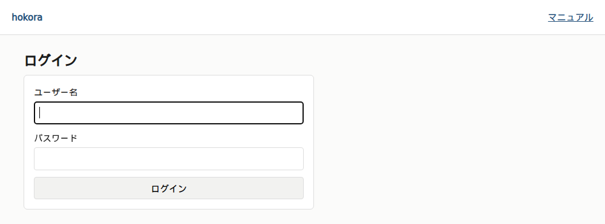
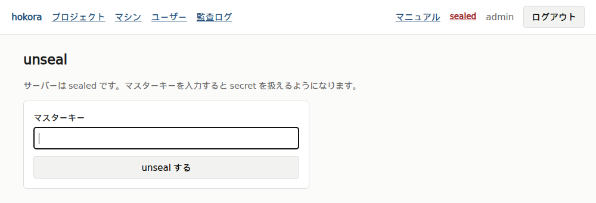
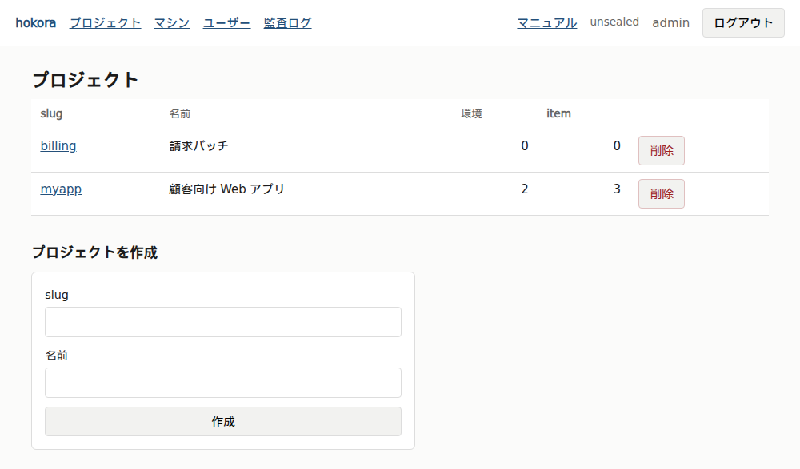
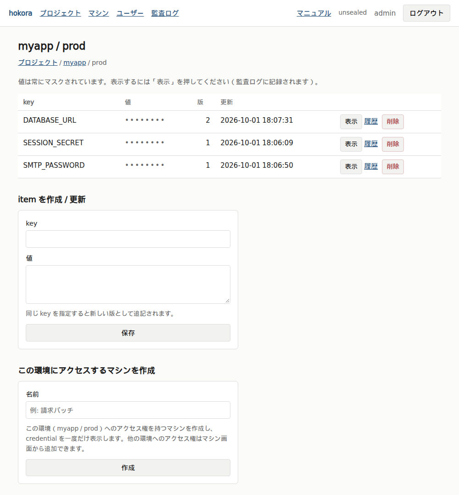
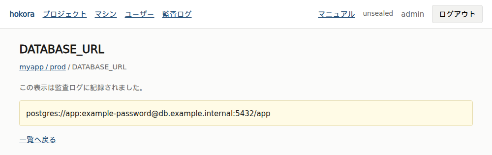
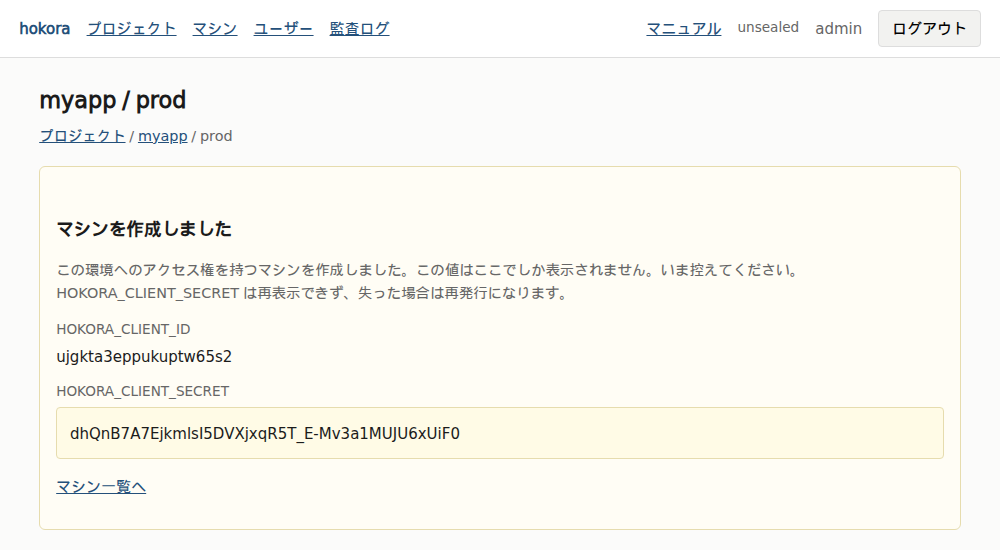
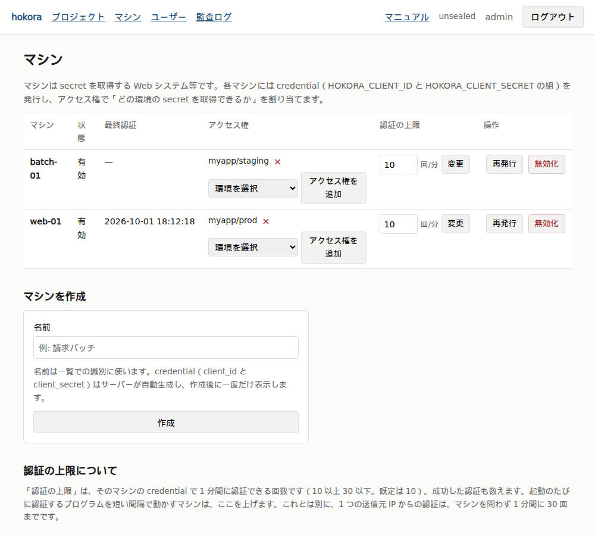
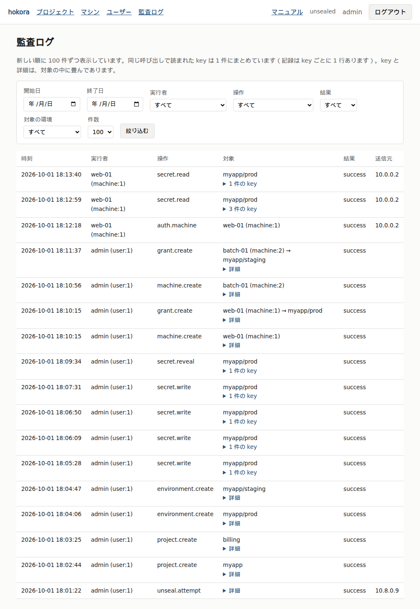

# Web UI の使い方

Web UI は、人が secret、マシン、アクセス権、ユーザーを管理し、監査ログを確かめる画面です。
言葉の意味は [用語集](glossary.md) を見てください。

## 前提

- VPN の内側からだけ開けます。
  URL は `https://<Web UI のホスト名>:8443/ui/login` です（ポートは既定値です）
- JavaScript を有効にしてください。
  平文を表示した画面をブラウザの「戻る」で開き直したときに、平文を消す処理に使っています。
  無効にすると、戻る操作で平文が画面に残ることがあります
- ロールは admin の 1 種類だけです。
  ログインできるユーザーは、このページの全ての操作をできます

このページの画面の例は、撮影用に入れた架空のデータです。
写っている credential と secret の値は、どこでも使えません。

## 画面の構成

上部のバーに、次のものが並びます。

| 表示 | 内容 |
|---|---|
| プロジェクト | プロジェクトの一覧。secret はここから辿ります |
| マシン | マシンの一覧、credential の再発行、アクセス権の割り当て |
| ユーザー | Web UI にログインするユーザーの一覧 |
| 監査ログ | 操作と読み取りの記録 |
| マニュアル | このマニュアルを新しいタブで開きます。ログイン前の画面にも出ます |
| `sealed` / `unsealed` | サーバーの状態。`sealed` は unseal の画面へのリンクです |
| ユーザー名とログアウト | ログイン中のユーザー |

## 初回のログイン

`hokora init` が出力した初期 admin のユーザー名とパスワードでログインします。



1. ログインすると、パスワード変更の画面に移ります。
   新しいパスワード（12 文字以上）を設定します
2. サーバーが sealed なら、unseal の画面に移ります。
   マスターキーを入力して「unseal する」を押します
3. プロジェクトの一覧が出れば、使い始められます



サーバーを再起動すると sealed に戻ります。
そのたびに unseal が必要です。
unseal は Web UI のほか、サーバー上のコマンドでもできます（[コマンド一覧](cli.md)）。

seal は Web UI からはできません。
サーバー上で `hokora seal` を実行します。

## secret を登録する

secret は「プロジェクト → 環境 → item」の階層に入れます。

### プロジェクトを作る

「プロジェクト」の画面の下にある「プロジェクトを作成」で、slug と名前を入れて「作成」を押します。



- slug は小文字の英字、数字、ハイフンで書きます（先頭は英字か数字、64 文字まで）。
  アプリが取得するときに指定する値です
- 名前は一覧に出す説明で、省略できます

### 環境を作る

プロジェクトの slug を押して開き、「環境を作成」で slug と名前を入れます。
`prod`、`staging` のように、実行環境ごとに作ります。

### item を作る、値を更新する

環境の slug を押して開き、「item を作成 / 更新」で key と値を入れて「保存」を押します。



- key は大文字の英字、数字、アンダースコアで書きます（先頭は英字かアンダースコア、128 文字まで）。
  例は `DATABASE_URL` です
- 値は、有効な UTF-8 で、NUL バイトを含まず、64 KB 以下である必要があります
- 既にある key を指定すると、値は上書きされず、新しい版として足されます。
  アプリが次に取得したときから、新しい版が返ります

値を更新しても、動いているアプリには届きません。
アプリは取得した値をメモリに持っているので、アプリを再起動するか、アプリ側で取得し直す必要があります。

### 値を確かめる

一覧では、値は常に `••••••••` と伏せてあります。
「表示」を押すと、その item の平文が出ます。



- **「表示」を押すたびに、監査ログに `secret.reveal` として記録されます**
- 平文をクリップボードにコピーするボタンはありません
- 確かめ終えたら「一覧へ戻る」で画面を離れてください

### 履歴を見る

item の「履歴」を押すと、版の一覧が出ます。
版ごとに、作成の日時と作成者が分かります。
過去の版も「表示」で平文を確かめられます（これも監査ログに記録されます）。

古い版に戻す操作はありません。
戻したいときは、古い版の値を新しい版として保存し直します。

### 削除する

プロジェクト、環境、item には、それぞれ「削除」のボタンがあります。

- **確認の画面は出ません。押すとすぐに削除されます**
- **Web UI から元に戻す操作はありません**
- プロジェクトを削除すると、その下の環境と item は全て取得できなくなります。
  環境の削除も同じです
- 削除した slug と key は、新しく作るときに再び使えます。
  ただし、削除したものとは別のものとして作られ、値や履歴は引き継ぎません
- 削除しても、アプリが取得済みの値は残ります。
  値を無効にしたいときは、その secret 自体を発行元で作り直します

## マシンとアクセス権を管理する

アプリが secret を取得するには、マシンと、そのマシンへのアクセス権が要ります。

### マシンを作る

作り方は 2 つあります。

| 作る場所 | 結果 |
|---|---|
| 環境の画面の「この環境にアクセスするマシンを作成」 | マシンを作り、その環境へのアクセス権も同時に付けます |
| 「マシン」の画面の「マシンを作成」 | マシンだけを作ります。アクセス権は後から付けます |

どちらも、入れるのは名前だけです。
名前は一覧で見分けるためのものです。

作成すると、credential が表示されます。



表示されるのは、次の 2 つの値です。

```
HOKORA_CLIENT_ID      ...
HOKORA_CLIENT_SECRET  ...
```

**この画面は 1 回しか出ません。`HOKORA_CLIENT_SECRET` は後から見直せません。**
その場で控えて、アプリサーバーの credential ファイルに書きます（[アプリから secret を取得する](clients.md)）。
控え損ねたら、再発行します。

### アクセス権を付ける、外す

「マシン」の画面の「アクセス権」の列で操作します。



- 付けるときは、「環境を選択」から環境を選び、「アクセス権を追加」を押します
- 外すときは、並んでいる `プロジェクト/環境` の横の「×」を押します。
  押した時点で、そのマシンはその環境の secret を取得できなくなります

アクセス権は環境の単位です。
アクセス権のある環境の item は、全て取得できます。
必要な環境にだけ付け、使わなくなったら外してください。

1 つのマシンに複数の環境のアクセス権を付けられます。
どの環境から取得するかは、アプリ側の設定（`HOKORA_PROJECT` と `HOKORA_ENV`）で決まります。

### credential を再発行する

「操作」の列の「再発行」を押すと、新しい `HOKORA_CLIENT_SECRET` が表示されます。

- 古い `HOKORA_CLIENT_SECRET` は、その時点で使えなくなります
- そのマシンの発行済みのトークンも、全て無効になります
- **アプリサーバーの credential ファイルを書き換えるまで、アプリは認証に失敗します。**
  先にファイルを差し替える手段はないので、再発行したらすぐに配ります

### マシンを無効化する

「無効化」を押すと、そのマシンは認証できなくなり、発行済みのトークンも全て無効になります。

- **無効化を取り消す操作はありません。**
  再び使うときは、新しいマシンを作ります
- マシンは削除できません。
  監査ログの実行者として残すためです

### 認証の上限を変える

「認証の上限」は、そのマシンの credential で 1 分間に認証できる回数です。
既定は 10 回で、30 回まで上げられます。
値を入れて「変更」を押すと、次の認証から新しい上限になります。

起動時に 1 回だけ取得するアプリは、既定のままで足ります。
上げるのは、cron から短い間隔で `hokora-client` を起動するような、起動のたびに認証する使い方のマシンだけです。
決め方は [運用 Runbook](../OPERATIONS.md) の §8.7 にあります。

### 漏れた疑いがあるとき

1. 該当するマシンを無効化するか、credential を再発行します
2. 使っていないアクセス権を外します
3. **そのマシンが取得できた secret を、発行元で 1 つずつ作り直します**（DB のパスワードを変える、API トークンを再発行する、など）

1 と 2 で止まるのは、それ以降の取得だけです。
3 を省くと、取得済みの値は使えるままです。
手順は [運用 Runbook](../OPERATIONS.md) の §11 にあります。

## ユーザーを管理する

### ユーザーを作る

「ユーザー」の画面の「ユーザーを作成」で、ユーザー名を入れて「作成」を押します。
初期パスワードはサーバーが生成し、その場で 1 回だけ表示されます。
本人に渡してください。
本人は、初回のログインでパスワードの変更を求められます。

### 自分のパスワードを変える

上部のバーにリンクはありません。
`/ui/password` を直接開きます。
現在のパスワードと、新しいパスワード（12 文字以上）を入れます。
変更すると、そのユーザーの他のログインは全て切れます。

他のユーザーのパスワードを変える操作はありません。
パスワードを忘れたユーザーは無効化し、別のユーザー名で作り直します。

### ユーザーを無効化する

「無効化」を押すと、そのユーザーはログインできなくなり、ログイン中のセッションも全て切れます。

- 自分自身は無効化できません
- **無効化を取り消す操作はありません。**
  無効化したユーザー名は、再び使えません

## 監査ログを確かめる

「監査ログ」の画面に、新しい順で記録が並びます。



| 列 | 内容 |
|---|---|
| 時刻 | 操作の時刻 |
| 実行者 | ユーザー、マシン、または `anonymous` |
| 操作 | `secret.read`、`secret.reveal`、`auth.machine` などの種類 |
| 対象 | `プロジェクト/環境` まで。key や理由は、行の中を開くと出ます |
| 結果 | `success` か `failure` |
| 送信元 | 送信元の IP アドレス |

- 1 回の呼び出しで複数の key を読んだ記録は、1 行にまとめて出ます。
  「N 件の key」を開くと、読まれた key が出ます。
  記録そのものは key ごとに 1 行あります
- 開始日、終了日、実行者、操作、結果、対象の環境で絞り込めます。
  日付はサーバーのローカル時刻で、終了日はその日を含みます
- key では絞り込めません。
  特定の key の読み取りを調べるときは、対象の環境と操作（`secret.read`）で絞り、行を開いて探します
- Web UI から監査ログを消すことはできません

`secret.read` の `success` は「secret の送信を始めた」という意味です。
調査では「その値は漏れたかもしれない」と読みます。

画面の詳しい動きと、DB を直接調べる方法は [運用 Runbook](../OPERATIONS.md) の §12 にあります。

## ログアウトとセッションの期限

- 上部のバーの「ログアウト」で、セッションを終えます
- 操作しないまま 2 時間が過ぎると、セッションは切れます
- 操作を続けていても、ログインから 12 時間でセッションは切れます

## 困ったとき

| 症状 | 見るところ |
|---|---|
| どの画面を開いても unseal の画面に移る | サーバーが sealed です。マスターキーで unseal します |
| ログインの画面に戻される | セッションが切れています。ログインし直します |
| ブラウザの「戻る」で平文が残る | JavaScript が無効になっていないか確かめます |
| credential を控え損ねた | 「再発行」で新しい `HOKORA_CLIENT_SECRET` を出します |
| アクセス権を付けたのにアプリが取得できない | アプリ側の `HOKORA_PROJECT` と `HOKORA_ENV` が、アクセス権を付けた環境と合っているか確かめます |

サーバー側の症状は [運用 Runbook](../OPERATIONS.md) の §13 にあります。
